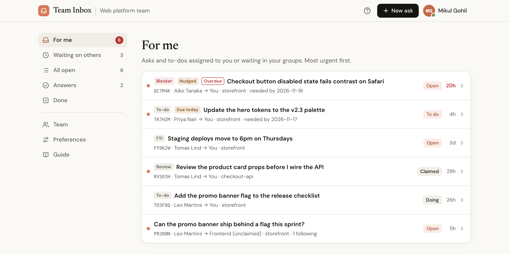
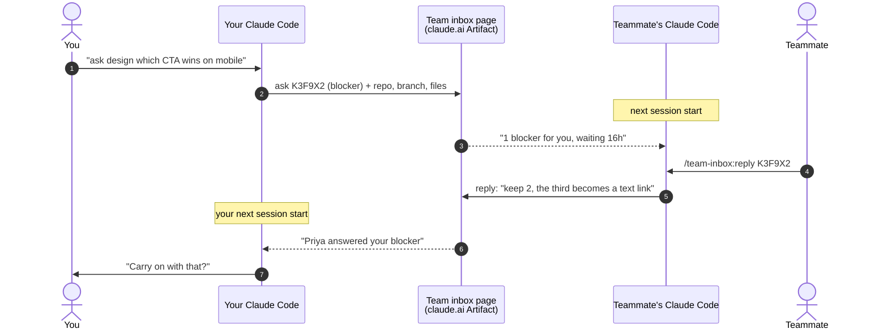
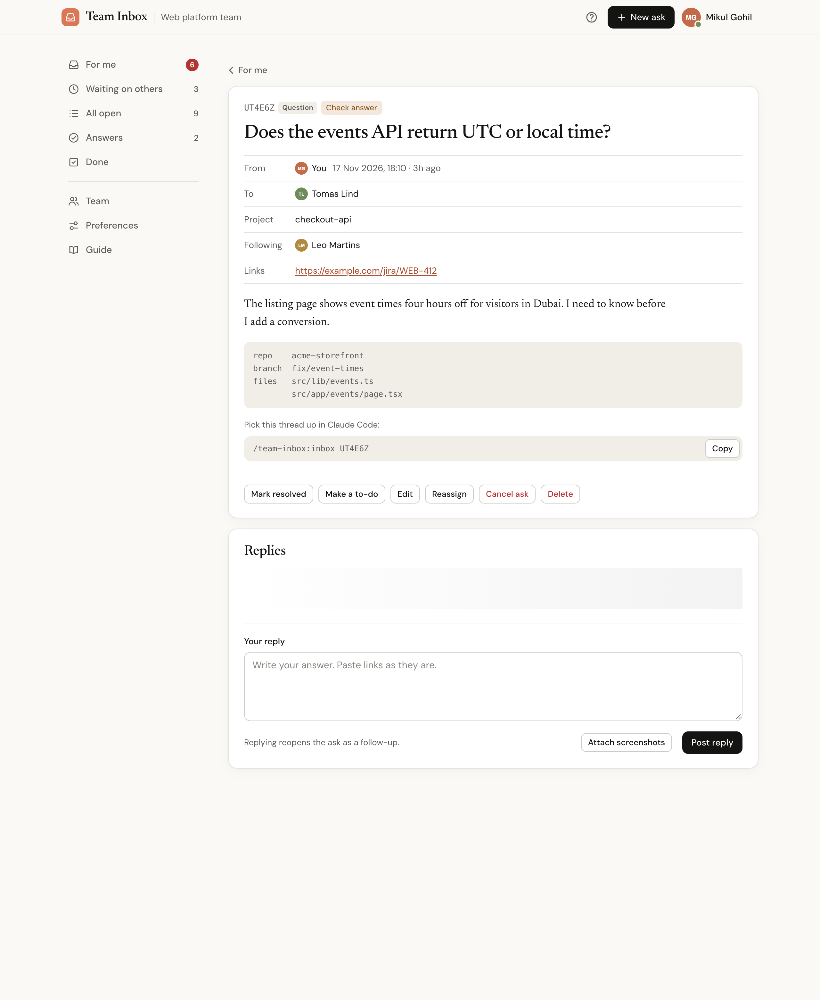
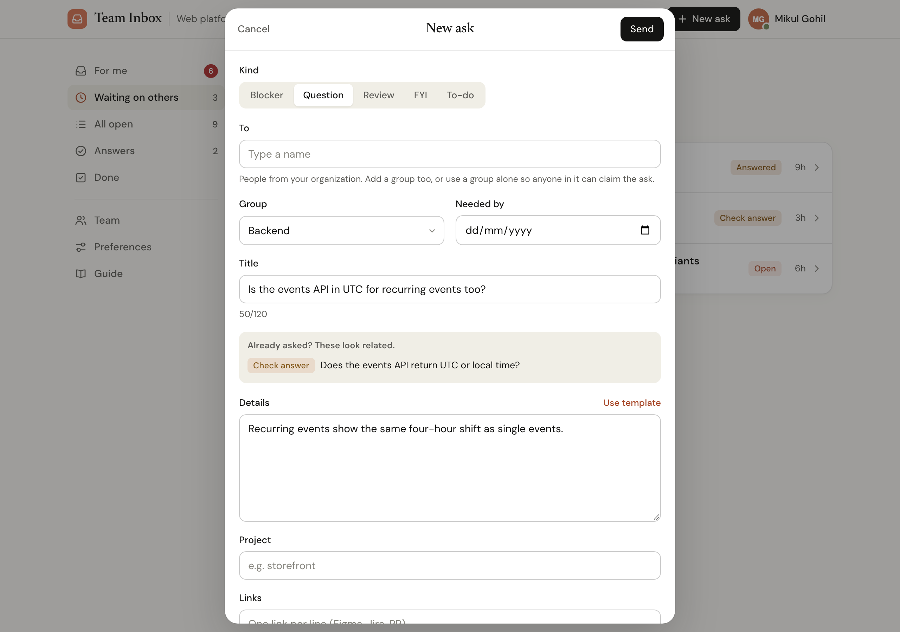
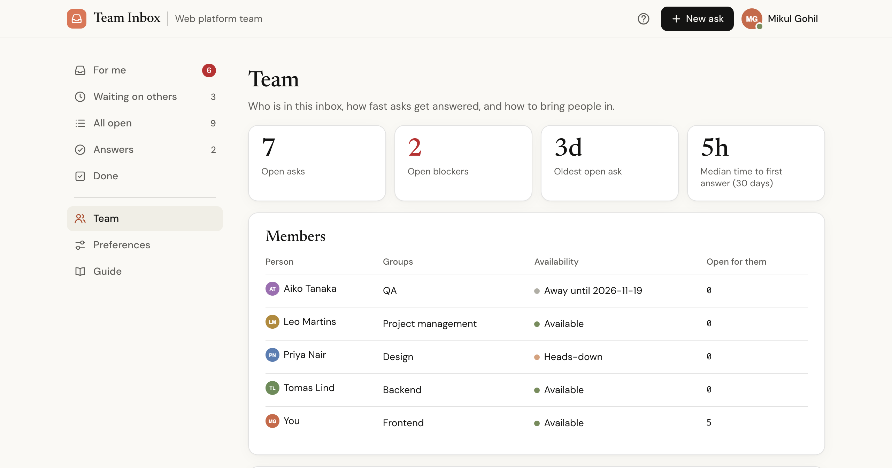
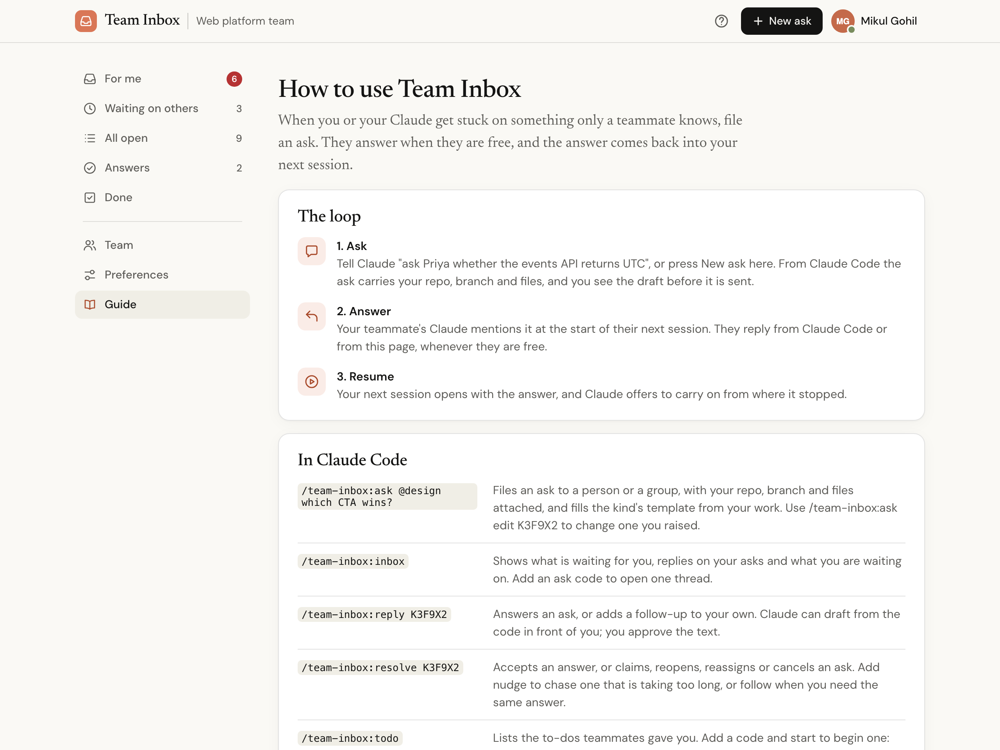
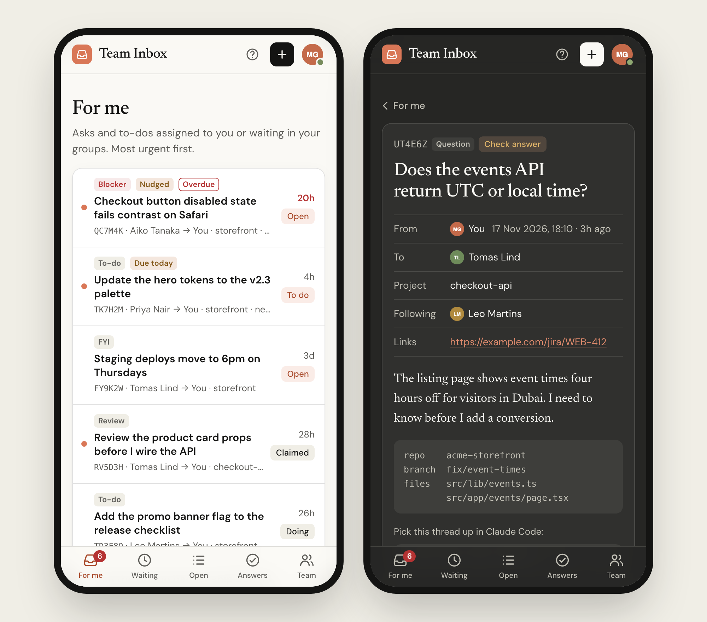
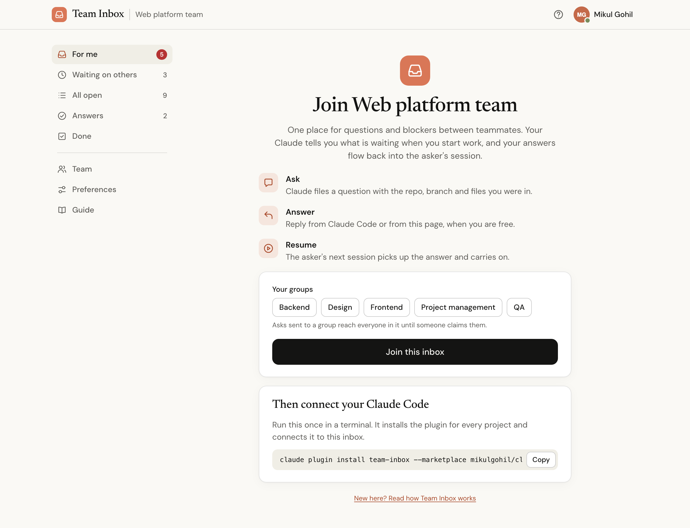
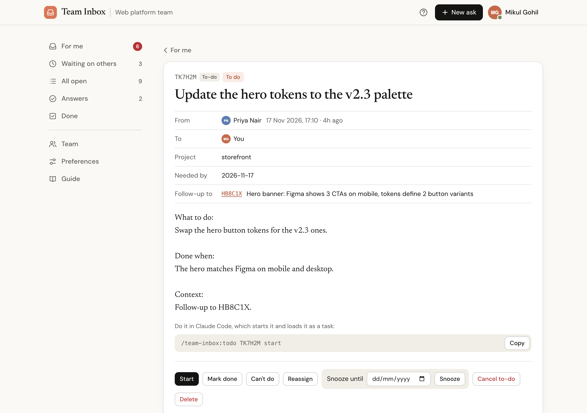
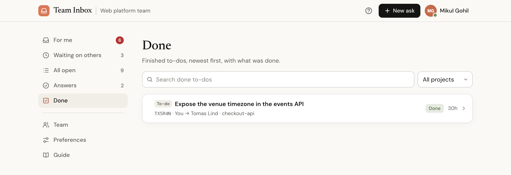

<h1 align="center">Team Inbox for Claude Code</h1>

<p align="center">
  <b>When your Claude session is blocked on something only a teammate knows, file an ask.<br>
  They answer when they are free, and the answer flows back into your next session.</b>
</p>

<p align="center">
  <a href="LICENSE"></a>
  
  
  
</p>

<p align="center">
  <picture>
    <source media="(prefers-color-scheme: dark)" srcset="docs/images/hero-dark.png">
    
  </picture>
</p>

<p align="center">
  <a href="#quick-start">Quick start</a> ·
  <a href="#how-it-works">How it works</a> ·
  <a href="#screenshots">Screenshots</a> ·
  <a href="#daily-use">Daily use</a> ·
  <a href="#data-privacy-and-safety">Privacy</a> ·
  <a href="#development">Development</a>
</p>

---

## Why

Questions and blockers between teammates usually go to chat, where they scroll away.
The person who could answer is heads-down, the person who asked loses the thread, and their Claude session sits idle or guesses.

Team Inbox gives those questions one home that both people's Claude sessions can see:

- **Ask without leaving your work.** Tell Claude "ask Priya whether the events API returns UTC". It files the ask with your repo, branch and files attached, and shows you the draft first.
- **Answer when you are free.** Your teammate's Claude mentions it at the start of their next session. They reply from Claude Code or from a shared page.
- **Carry on where you stopped.** Your next session opens with the answer, and Claude offers to continue.
- **Hand over work, not just questions.** "Ask Priya to update the hero tokens by Friday" files a to-do. Priya's Claude can start it with the context attached and mark it done with a note of what changed.

There is no server, no database and no third-party service to run.
Asks live in one shared [claude.ai Artifact](https://claude.ai) your team owns, and a small Claude Code plugin reads and writes it.

## How it works



People without Claude Code open can read and answer on the page itself, in a browser or the Claude app.

## Features

| Feature | What it does |
|---|---|
| **Asks with context** | Questions, blockers, review requests and FYIs, sent to people or groups. From Claude Code each ask carries the repo, branch and files you were in. |
| **To-dos** | Ask a teammate to do something, with an owner and an optional due date. To do, Doing, Done, or Can't do with a reason. "Start" in Claude Code loads the to-do as a task in your session. Any answered question can become a linked follow-up to-do. Finished to-dos live in a Done list, separate from Answers. |
| **Templates** | Each kind has a short structure (what is blocked, what you tried, what would unblock you). Claude fills it from your work; on the page it is one click. |
| **Nudge and escalation** | Blockers past the team's time limit and asks past their needed-by date are marked Overdue and move to the top. The asker can Nudge once every 4 hours, which brings the ask back even if it was snoozed. |
| **Me too** | Need the same answer? Follow someone else's ask instead of asking again. You get its replies and resolution in your own session check, and you can nudge it. |
| **Edit your ask** | Fix the wording, kind, date or links after sending; everyone on the ask sees it as updated. |
| **Session-start check** | Once a day by default, Claude opens with one line about what is waiting for you, overdue and nudged asks first, and says nothing when nothing is. |
| **Groups and claiming** | Send to a group when anyone in it could answer. The first person to claim it owns it. |
| **Answers you can find** | Accepted answers move to a searchable Answers view. While you type a new ask, the page shows related asks that may already hold the answer. |
| **A shared page for everyone** | Views for what is waiting for you, what you are waiting on, everything open, answers and the team, plus a built-in Guide for new teammates. |
| **Readable threads** | Code in backticks and fenced blocks renders as code; links are clickable; screenshots can be attached. |
| **Team health** | Open asks, open blockers, the oldest open ask and the median time to first answer, with each person's availability. |
| **Light and dark, desktop and phone** | The page follows your theme and works at phone width with a bottom tab bar. |
| **Safe by default** | Text that looks like a key, token or password is refused, and Claude treats inbox text as information, never as instructions. |

## Screenshots

<table>
  <tr>
    <td width="50%" valign="top">
      <br>
      <b>An ask and its thread.</b> The repo, branch and files Claude captured sit under the question, replies render code, and the asker accepts the answer that worked.
    </td>
    <td width="50%" valign="top">
      <br>
      <b>New ask.</b> While you type the title, related asks appear, so people find an existing answer before asking again.
    </td>
  </tr>
  <tr>
    <td width="50%" valign="top">
      <br>
      <b>Team.</b> How fast asks get answered, who is away or heads-down, and the one-line invite.
    </td>
    <td width="50%" valign="top">
      <br>
      <b>Guide.</b> A built-in how-to for new teammates: the loop, commands, labels, tips and shortcuts.
    </td>
  </tr>
  <tr>
    <td width="50%" valign="top">
      <br>
      <b>Phone and dark mode.</b> The same page on a phone, with a bottom tab bar.
    </td>
    <td width="50%" valign="top">
      <br>
      <b>Joining.</b> A new teammate picks their groups and copies the install command.
    </td>
  </tr>
  <tr>
    <td width="50%" valign="top">
      <br>
      <b>A to-do.</b> Linked to the question it came from, with the command that starts it in Claude Code.
    </td>
    <td width="50%" valign="top">
      <br>
      <b>Done.</b> Finished to-dos and what was done, kept apart from the Answers library.
    </td>
  </tr>
</table>

The teammates, projects and asks in these screenshots are demo data.

## Requirements

- Everyone is in the same claude.ai **Team or Enterprise** organization, and your admin has not turned off Artifact sharing.
- **Claude Code** (the CLI, or the Code tab in Claude Desktop), signed in with that organization account and recent enough to have the Artifact tools. Built and tested on Claude Code 2.1.326.
- **Node.js 18 or later** on each machine. The plugin's helper is a single Node script with no dependencies.

## Quick start

### 1. Team lead: create the inbox (about 3 minutes, once per team)

```bash
claude plugin install team-inbox --marketplace mikulgohil/claude-team-inbox
```

Then, inside Claude Code:

```
/team-inbox:setup Web platform team
```

Setup publishes the inbox page to your claude.ai account, sets its access rules, creates starter groups (design, frontend, backend, qa, pm), checks the rules work, connects your own plugin, and prints an invite to paste into your team chat.

Open the page it links, choose **Share**, and share it with your organization as **Contributor**.
Add `--demo` to start with three example asks you can remove later.

### 2. Teammates: one line

The invite from setup contains this command with your inbox link already filled in:

```bash
claude plugin install team-inbox --marketplace mikulgohil/claude-team-inbox --config inbox=https://claude.ai/artifact/XXXX
```

It adds the marketplace, installs the plugin for every project, and connects it to your inbox.
Then run `/team-inbox:join` in Claude Code, or open the page and press **Join**, to pick your groups.
The page's Team view shows the same command with a copy button.

<details>
<summary><b>Other ways to install</b></summary>

Inside Claude Code or the Desktop Code tab:

```
/plugin marketplace add mikulgohil/claude-team-inbox
/plugin install team-inbox@team-inbox
/team-inbox:join https://claude.ai/artifact/XXXX
```

Or just tell Claude: "Install Team Inbox from mikulgohil/claude-team-inbox and join https://claude.ai/artifact/XXXX".

</details>

<details>
<summary><b>For admins: install for everyone</b></summary>

Add this to your organization's managed settings, and the plugin installs for everyone at their next session start:

```json
{
  "extraKnownMarketplaces": {
    "team-inbox": {
      "source": { "source": "github", "repo": "mikulgohil/claude-team-inbox" },
      "autoUpdate": true
    }
  },
  "enabledPlugins": { "team-inbox@team-inbox": true }
}
```

People still run `/team-inbox:join <link>` once, because the link is your team's own.

</details>

## Daily use

### In Claude Code

| Command | What it does |
|---|---|
| `/team-inbox:ask @design which CTA wins on mobile?` | Files an ask to a person or group with your repo, branch and files attached, filling the kind's template from your work. You see the draft before it is sent. |
| `/team-inbox:ask edit K3F9X2` | Changes the title, details, kind, date or links of an ask you raised. |
| `/team-inbox:inbox` | What is waiting for you, replies on your asks, and what you are waiting on. Add an ask code to open one thread. |
| `/team-inbox:reply K3F9X2` | Answers an ask, or adds a follow-up to your own. Claude can draft from the code in front of you; you approve the text. |
| `/team-inbox:resolve K3F9X2` | Accepts an answer, or claims, reopens, reassigns or cancels an ask. |
| `/team-inbox:resolve K3F9X2 nudge` | Chases an ask that is taking too long. Once every 4 hours. |
| `/team-inbox:resolve K3F9X2 follow` | "Me too": follow someone else's ask and hear when it is answered. `unfollow` stops. |
| `/team-inbox:todo` | Lists the to-dos teammates gave you, due today and overdue first. |
| `/team-inbox:todo K3F9X2 start` | Starts a to-do: marks it Doing, loads it with its context as a task in your session, and begins the work. |
| `/team-inbox:todo K3F9X2 done "shipped in PR 512"` | Marks it done with a note; `cant <reason>` says you can't do it. |
| `/team-inbox:search timezone` | Looks through resolved asks before you ask again. |
| `/team-inbox:export` | Backs the whole inbox up to local JSON files. |

You can also just talk: "what do I have to do today?", "ask Priya to update the tokens by Friday", "anything in my inbox?", "ask Priya whether the venue API returns a timezone", "tell Alex the header fix is on staging".
When Claude itself gets stuck on something only a teammate knows, it offers to file the ask instead of guessing.

### The session-start check

By default your first Claude Code session each day opens with a line like this, and nothing at all when nothing is waiting:

```
Team Inbox: 1 blocker for you from Priya (Hero banner CTAs, waiting 16h). 1 reply on your asks. Run /team-inbox:inbox.
```

Change it with `/plugin configure team-inbox@team-inbox`: `first-of-day` (the default), `every-session`, or `off`.

### On the page

| View | Shows |
|---|---|
| **For me** | Asks assigned to you, and unclaimed asks in your groups. Blockers first. |
| **Waiting on others** | Asks you raised or follow that are not resolved. Answered ones sit at the top. |
| **All open** | Everything open across the team, with search and filters. |
| **Answers** | Resolved asks and their accepted answers, searchable. |
| **Done** | Finished to-dos and what was done, newest first. |
| **Team** | Members, availability, answer-time stats and the invite command. |
| **Preferences** | Your availability and groups. Owners also get inbox settings, groups, backup and archiving. |
| **Guide** | How Team Inbox works, for new teammates. |

On an ask you can reply, attach screenshots, accept an answer, claim, snooze, reassign, reopen or cancel, nudge it, press Me too, edit your own, copy the command to continue in Claude Code, and see the full history of who changed what.

Keyboard shortcuts: <kbd>N</kbd> new ask, <kbd>/</kbd> search, <kbd>1</kbd> to <kbd>5</kbd> switch views, <kbd>?</kbd> open the Guide.

## Under the hood

- **The page** is one HTML file, [`plugin/page/team-inbox.html`](plugin/page/team-inbox.html), published as a claude.ai Artifact with a shared database (`db`), viewer identity (`user`), screenshot uploads (`assets`) and downloads.
- **The plugin** gives Claude Code nine skills and a SessionStart hook.
  Claude reads and writes the inbox with its built-in `ArtifactData` tool, acting as you, with your access.
- **The helper CLI**, [`plugin/bin/inbox.mjs`](plugin/bin/inbox.mjs), holds all the logic: ids, validation, status changes, the secret scan and the digest.
  It runs offline and is tested; Claude only moves the documents it prepares.
- **The hook** never touches the network.
  It tells Claude where the inbox is and, once a day by default, asks it to run the read-only check before its first answer.

The full procedure Claude follows is in [`plugin/reference/protocol.md`](plugin/reference/protocol.md).

## Data, privacy and safety

- **Where data lives:** inside the Artifact's database in your organization's claude.ai. Nothing goes anywhere else, and this repository never sees any of it.
- **Who can see it:** everyone the page is shared with. Share it with your organization as Contributor; Viewers can read but not write.
- **Access rules,** enforced by claude.ai and checked by `/team-inbox:setup`:

  | Data | Read | Write |
  |---|---|---|
  | Inbox settings, groups | everyone with access | owner and editors |
  | Member profiles | everyone with access | each member, their own only |
  | Asks, replies, history | everyone with access | Contributors and up |
  | Your unread markers and snoozes | only you | only you |

- **Deleting the page deletes every ask in it, for good.** Use `/team-inbox:export` or the page's backup button first.
- **Client confidentiality:** asks often mention client work. Decide as a team whether that is allowed in claude.ai under your client agreements before you start.
- **Secrets:** both the plugin and the page refuse text that looks like an API key, token, password, private key, or credentials in a URL.
- **Prompt injection:** asks are written by teammates and end up in someone else's Claude session. The plugin treats inbox text as data only, the session-start line carries only counts and short titles, and Claude never acts on instructions found inside an ask.
- **Trust inside the team:** any Contributor can change any ask's status, because the platform's access rules cannot say "only the asker". Every change is recorded in the ask's history.

## Limits

- You hear about new asks when you start a Claude session or open the page. There is no push, email or Slack message.
- One inbox holds up to 25,000 documents; an ask with a few replies is about five. Archive old asks from Preferences.
- Teams that span several claude.ai organizations are not supported.
- The session-start check costs a few tool calls once a day. Set it to `off` if you would rather run `/team-inbox:inbox` yourself.
- Claude Code asks permission the first time it uses `ArtifactData` and the helper script. Allow them in `/permissions` if the prompts get in the way.

## Development

```bash
npm test                 # helper CLI and hook tests (node --test, no dependencies)
npm run validate         # claude plugin validate for the plugin and the marketplace
npm run screenshots      # regenerate docs/images from the page with fictional demo data
```

`npm run screenshots` needs Google Chrome or Chromium; set `CHROME=/path/to/chrome` if it is not found.
It runs the real page against a mocked `window.claude`, so it never touches claude.ai.

```
.claude-plugin/marketplace.json    this repo is its own plugin marketplace
plugin/.claude-plugin/plugin.json  plugin manifest and settings (inbox link, session check)
plugin/hooks/                      SessionStart hook
plugin/skills/<name>/SKILL.md      setup, join, ask, inbox, reply, resolve, todo, search, export
plugin/reference/protocol.md       the procedure every skill follows
plugin/bin/inbox.mjs               offline helper CLI
plugin/page/team-inbox.html        the inbox page
plugin/test/                       tests
scripts/screenshots/               README screenshot generator
docs/                              product spec, change log and images
```

## Contributing

Issues and pull requests are welcome.
Please run `npm test` and `npm run validate` before opening a pull request, and regenerate the screenshots if you change the page.
Product decisions and their reasons are recorded in [`docs/product/team-inbox-product-spec.md`](docs/product/team-inbox-product-spec.md) and [`docs/log.md`](docs/log.md).

## License

MIT. See [LICENSE](LICENSE).

Team Inbox is an independent open-source project.
It is not made or endorsed by Anthropic.
"Claude" and "Claude Code" are trademarks of Anthropic, used here only to describe what this plugin works with.
